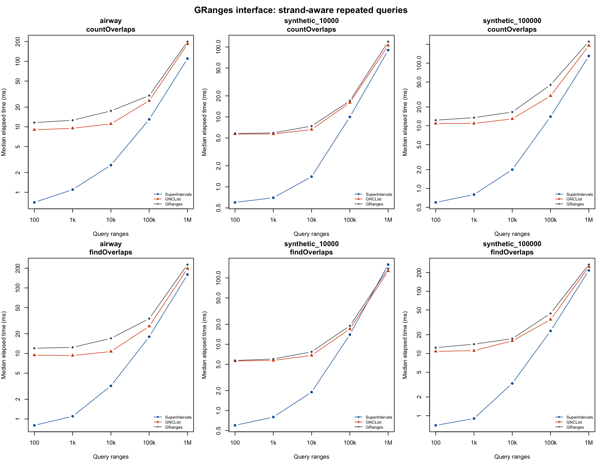

# superintervalsr

Fast overlap queries for genomic ranges in R.

`superintervalsr` wraps the [SuperIntervals](https://github.com/kcleal/superintervals)
C++ library. You build an index once, then query it many times. It works with
`GRanges` and the usual `findOverlaps()` and `countOverlaps()` functions.

The package is under review at Bioconductor.

## Installation

```r
install.packages(c("BiocManager", "remotes"))
BiocManager::install(c("S4Vectors", "IRanges", "GenomicRanges", "Seqinfo"))
remotes::install_github("kcleal/superintervalsr")
```

You need a C++17 compiler.

## With GRanges

Index the subject once with `SuperIntervalMap()`. Then pass it to
`findOverlaps()` or `countOverlaps()` in place of a `GRanges`.

```r
library(GenomicRanges)
library(superintervalsr)

genes <- GRanges(c("chr1", "chr1", "chr2"),
    IRanges(c(20, 1, 1), c(30, 10, 10)),
    strand = c("+", "*", "-"),
    gene_id = c("C", "A", "D"))
index <- SuperIntervalMap(genes)

query <- GRanges(c("chr1", "chr2"), IRanges(c(5, 3), c(25, 8)),
    strand = c("+", "-"))
hits <- findOverlaps(query, index)
countOverlaps(query, index)

# Subject hits point at rows of the original GRanges.
as_granges(index)[subjectHits(hits)]
```

Results match GenomicRanges:

- Strand works the same way. `"*"` matches either strand. Use
  `ignore.strand = TRUE` to ignore strand.
- Options the index does not handle itself are passed to GenomicRanges. These
  are `type` other than `"any"`, a `maxgap` or `minoverlap`, zero-width ranges,
  and circular sequences such as chrM.

Some things to know:

- The index does not update when you change the `GRanges`. Build a new one.
- You cannot save the index with `saveRDS()`. Save `as_granges(index)` and
  rebuild after loading.

The vignette has a full example using RNA-seq data from the `airway` package.

## Plain intervals

`IntervalMap` is the lower-level structure. It holds integer intervals on one
coordinate line, such as a single chromosome, and ignores strand. Each interval
can carry any R value.

```r
im <- IntervalMap(c(20, 1, 5), ends = c(30, 10, 15),
    values = c("C", "A", "B"))

search_items(im, 7, 12)              # intervals overlapping 7-12
search_point(im, 10)                 # values of intervals covering 10
count.batch(im, c(7, 25), c(12, 35)) # one count per query
```

You can also add intervals one at a time. Call `build()` before you query:

```r
im <- IntervalMap()
add(im, 1, 10, "A")
add(im, 5, 15, "B")
build(im)
search_values(im, 7, 12)
```

Points to keep in mind:

- Both ends of an interval are included, as in `IRanges`.
- Coordinates must be whole numbers in the R integer range, with no `NA`.
- Queries do not check their input or whether the map is built. This keeps
  them fast.
- `build()` sorts the intervals. Positions from `search_idxs()` refer to this
  sorted order, not your input order. To get back to input rows, store the row
  number as the value.
- Maps change in place. `other <- im` does not make a copy.

### Interval operations

These return a new, ready-to-query map:

| Function | Result |
|---|---|
| `merge_overlaps(x)` | overlapping intervals joined |
| `union_with(x, y)` | regions in either map, joined |
| `intersection(x, y)` | regions in both maps |
| `difference(x, y)` | regions in `x` but not `y` |
| `symmetric_difference(x, y)` | regions in exactly one map |
| `gaps(x, lo, hi)` | uncovered regions between `lo` and `hi` |
| `expand(x, left, right)` | each interval widened |
| `flank(x, left, right)` | regions beside each interval |
| `unique_intervals(x)` | duplicate intervals removed |

`span(x)` gives the start and end that cover everything, or `NULL` if empty.

Notes on values and edge cases:

- Merge and union keep one value per joined region.
- Intersection and difference keep values from `x`. Intersection can return
  overlapping pieces; run `merge_overlaps()` on the result to join them.
- Intervals that touch but do not overlap stay separate.
- `coverage(x, start, end)` returns the hit count and the total overlap width.
  Each interval is counted on its own, so shared bases count more than once.

Names such as `coverage()`, `gaps()` and `flank()` also exist in other
Bioconductor packages. Use `superintervalsr::coverage()` if in doubt.

## Benchmarks

Measured on macOS ARM64, R 4.6.1, Bioconductor 3.24.
Subjects are airway gene spans and two random sets spread over 22
chromosomes. Queries are promoter windows. Every result was checked against
GenomicRanges before timing.

Times are milliseconds per call, median of five runs, strand-aware. Lower is
better. "Prebuilt GNCList" is GenomicRanges with its index built in advance.
"GRanges" builds the index inside each call.

| Subject | Operation | Queries | SuperIntervals | Prebuilt GNCList | GRanges |
|---|---|---:|---:|---:|---:|
| airway | countOverlaps | 10,000 | 2.6 | 11 | 18 |
| airway | findOverlaps | 10,000 | 3.2 | 11 | 17 |
| airway | countOverlaps | 1,000,000 | 110 | 184 | 200 |
| airway | findOverlaps | 1,000,000 | 160 | 197 | 227 |
| synthetic_10000 | countOverlaps | 10,000 | 1.4 | 6.6 | 7.4 |
| synthetic_10000 | findOverlaps | 10,000 | 1.9 | 6.8 | 7.7 |
| synthetic_10000 | countOverlaps | 1,000,000 | 90 | 105 | 119 |
| synthetic_10000 | findOverlaps | 1,000,000 | 159 | 127 | 138 |
| synthetic_100000 | countOverlaps | 10,000 | 2.0 | 13 | 17 |
| synthetic_100000 | findOverlaps | 10,000 | 3.3 | 16 | 17 |
| synthetic_100000 | countOverlaps | 1,000,000 | 130 | 190 | 220 |
| synthetic_100000 | findOverlaps | 1,000,000 | 216 | 247 | 268 |

GenomicRanges has a fixed cost of several milliseconds per call. SuperIntervals
does not, so it is fastest relative to GenomicRanges below about 100,000
queries. At a million queries, `countOverlaps()` is still faster.
`findOverlaps()` is about even, and slower on the small random subject.

Index build time, in milliseconds:

| Subject | Ranges | SuperIntervalMap | GNCList |
|---|---:|---:|---:|
| airway | 63,677 | 8.0 | 16 |
| synthetic_10000 | 10,000 | 2.0 | 5.0 |
| synthetic_100000 | 100,000 | 13 | 20 |



Full results: [queries](inst/benchmarks/queries.csv),
[build times](inst/benchmarks/build.csv),
[session info](inst/benchmarks/session-info.txt).

To rerun:

```sh
Rscript inst/scripts/benchmark-genomic.R genomic-benchmark
```
